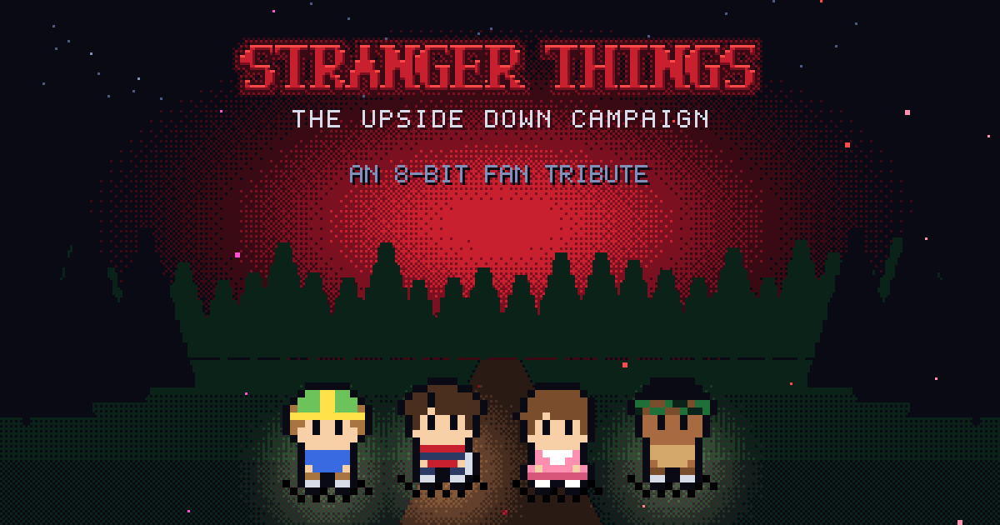
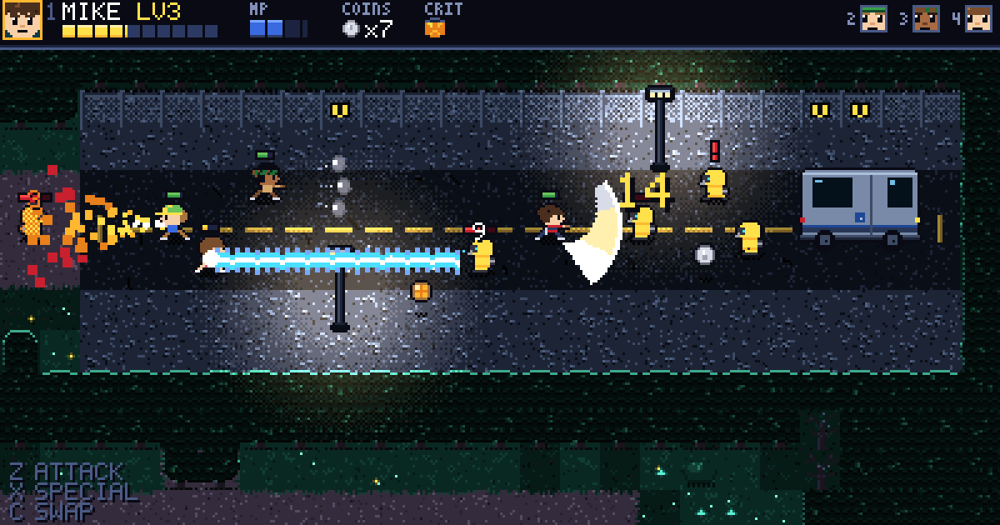
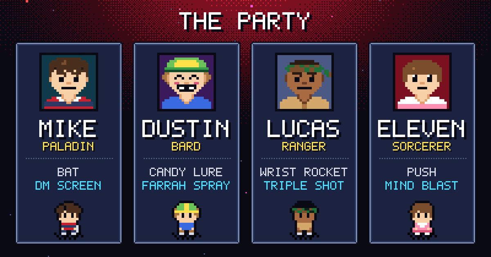

# Stranger Things 8-bit: The Upside Down Campaign

An 8-bit action RPG fan tribute. Mike runs one last D&D campaign in the basement, and you play it: a party of four, real-time fights, a d20 behind every level-up. This build is Levels 1 to 6: chapter 1 (Mirkwood, Hawkins Lab, the middle school and the Demogorgon) and chapter 2 (the arcade and pumpkin patch, the tunnels, and the Gate with the Demodog Alpha), joined by a Hawkins map between stages. It's here for feedback before the rest gets built.

**[Play it in your browser](https://miguelsolorio.github.io/upside-down-campaign/).** It works with a keyboard, an Xbox controller, a mouse or a touch screen.

## Controls

| Input | Action |
| --- | --- |
| `W` `A` `S` `D` or arrows | Move |
| `Z` or `J` | Attack |
| `X` or `K` | Special. Costs MP |
| `C` and `V` | Swap hero |
| `1` to `4` | Pick a hero |
| `Space` or `Enter` | Light Joyce's Christmas lights, or Crit when the d20 is full. Advances dialogue |
| `Esc` or `P` | Pause and settings |
| Click your hero's level | Character sheet: every hero's stats and damage. Also in the pause menu |
| `T` | Skip dialogue |
| `M` | Mute |

Press any key once so the browser lets the sound start. Plug in a controller and press a button to play with it, menus included. Phones and tablets turn into a Game Boy, with the game in its screen and a D-pad, A, B, SELECT and START that work. You can rebind keys in the options. The full list is in [docs/controls.md](docs/controls.md).

## How it plays

- **Swap to solve.** Some gates, logs and crates only open for one hero. Try one with the wrong hero and the game tells you who to send.
- **Roll for it.** Every level-up rolls a d20. A 20 is a full heal and a team buff, and nothing can make a hero worse.
- **Pick the party.** From the tunnels on, six heroes can go and four fit. The map asks who, and keeps the one a stage can't be cleared without.
- **Save at the lights.** Light Joyce's Christmas lights and the game saves. The title offers CONTINUE.
- **Story is off by default.** Press `T` on the title to turn it on.
- **The Lab is hard.** Riot guards block from the front, cameras call in reinforcements and the Warden waits at the end.

## About

Not affiliated with Netflix. The code, art, music and lines are original. Every sprite and every note is generated in code, so the game loads no asset files.

Building or changing the game? See [docs/development.md](docs/development.md).
