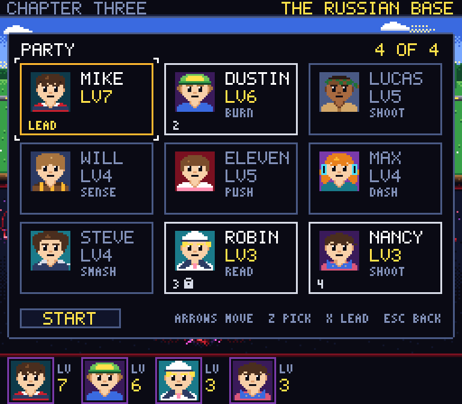
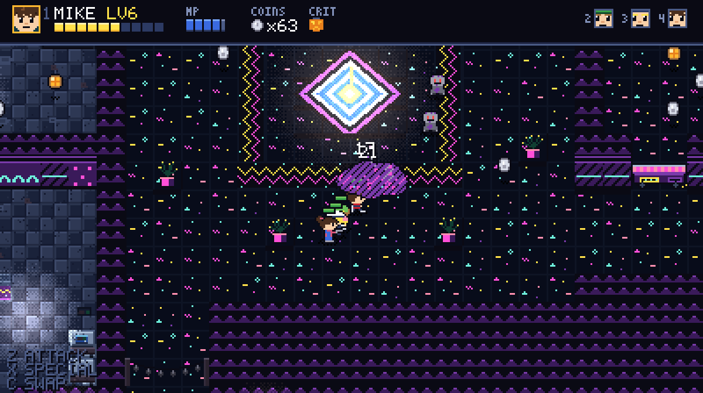

# Stranger Things 8-bit: The Upside Down Campaign

An 8-bit action RPG fan tribute. Mike runs one last D&D campaign in the basement, and you play it: a party of four, real-time fights, a d20 behind every level-up. This build is Levels 1 to 8: chapter 1 (Mirkwood, Hawkins Lab, the middle school and the Demogorgon), chapter 2 (the arcade and pumpkin patch, the tunnels, and the Gate with the Demodog Alpha) and the first two stages of chapter 3 (Starcourt Mall, and the Russian base under it where Grigori waits), joined by a Hawkins map between stages. Nine heroes can play and four go at a time. It stops at the base: the food court is locked on the map and the rest is still being made. It's here for feedback before that gets built.

**[Play it in your browser](https://miguelsolorio.github.io/upside-down-campaign/).** It works with a keyboard, an Xbox controller, a mouse or a touch screen.

## Controls

| Input | Action |
| --- | --- |
| `W` `A` `S` `D` or arrows | Move |
| `Z` or `J` | Attack |
| `X` or `K` | Special. Costs MP |
| `C` and `V` | Swap hero |
| `1` to `4` | Pick a hero |
| `Space` or `Enter` | Light Joyce's Christmas lights, play an arcade cabinet in the Palace, or Crit when the d20 is full. Advances dialogue |
| `U` or `B` | Crit, even next to the lights |
| `Esc` or `P` | Pause and settings |
| Click your hero's level | Character sheet: every hero's stats and damage. Also in the pause menu |
| `T` | Skip dialogue |
| `M` | Mute |
| On the map | `Z` or `Space` enters a stage and `X` opens Erica's cart. In the party panel, `Z` picks a hero and `X` makes them the lead |

Press any key once so the browser lets the sound start. You can rebind keys under CONTROLS in the options. The full list is in [docs/controls.md](docs/controls.md).

A controller plays the whole game, menus included: plug in an Xbox controller and press a button. Its attack, special, swap and Crit buttons rebind on the GAMEPAD page of CONTROLS, and a controller that can buzz rumbles on a hit, a knockout, a level-up and a boss slam.

Phones and tablets turn into a Game Boy, with the game in its screen and a D-pad, A, B, SELECT and START that work. It's the grey one by day and the black one when the phone goes dark, and GAME BOY in the options can lock it to either.

The game pauses by itself when you look away: another window or tab, or the controller you were playing with dropping out.

## How it plays

- **Swap to solve.** Some gates, logs, crates and doors only open for one hero: Dustin burns, Lucas and Nancy shoot, Eleven pushes, Will senses hidden paths, Max dashes gaps, Steve smashes cracks and Robin reads Russian. Try one with the wrong hero and the game tells you who to send.
- **Roll for it.** Every level-up rolls a d20. A 20 is a full heal and a team buff, and nothing can make a hero worse.
- **Pick the party.** From the tunnels on, more heroes can go than fit. The map asks who, and keeps the one a stage can't be cleared without. Robin and Nancy join at the mall, which makes nine to pick from.

- **Shop at Erica's cart.** Once the Gate is behind you, `X` on the map opens her cart. An Eggo is 15 quarters and a Coke is 9, and the party carries three of each. It eats an Eggo when someone is nearly down and drinks a Coke when Special runs dry.
- **Save at the lights.** Light Joyce's Christmas lights and the game saves. The title offers CONTINUE.
- **Story is off by default.** Press `T` on the title to turn it on.
- **The Lab is hard.** Riot guards block from the front, cameras call in reinforcements and the Warden waits at the end.
- **The mall bites back.** Flayed grab your hero, and a swap or a hard hit breaks the hold. Soldiers shoot from across the room, and Grigori guards his front, so go around him.

## About

Not affiliated with Netflix. The code, art, music and lines are original. Every sprite and every note is generated in code, so the game loads no asset files.

Building or changing the game? See [docs/development.md](docs/development.md).
